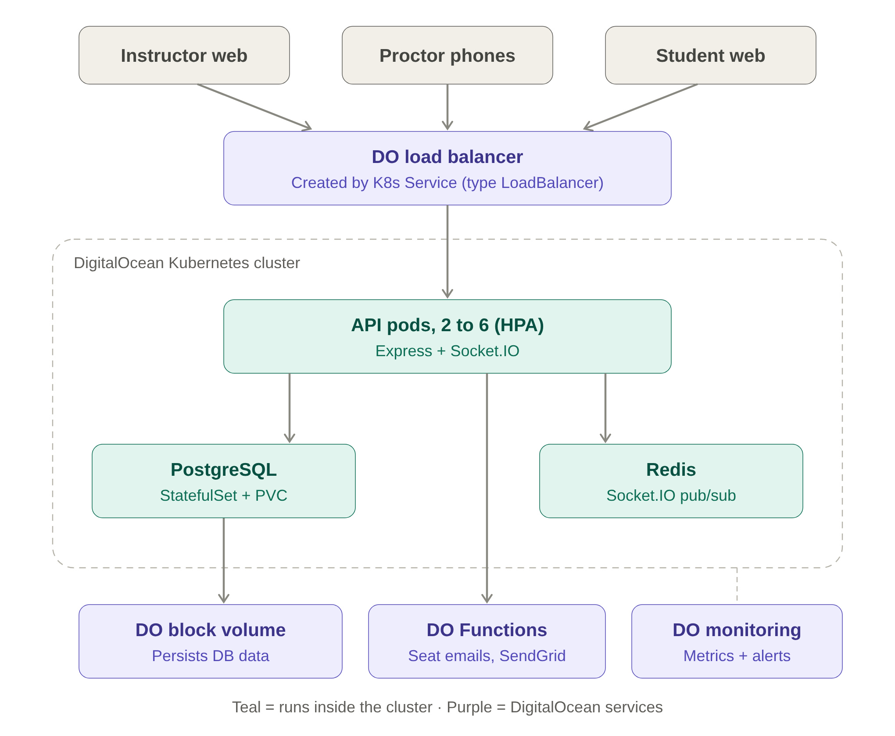

# Project Proposal - RollCall

**Ahmed Afifi** · **Mohammed Abdulmunem** · **Omar Mouftah**

---

## Motivation

### The problem

Running an examination for a large course is mostly a logistics problem. Staff must split students across rooms, assign and spread out seats to discourage copying and make sure students with accessible or left-handed needs get suitable seats. On exam day, staff in each room confirm who arrived, identify and direct students in the wrong room, and check who is missing. This is usually done with pen and paper or spreadsheets, and staff in different rooms cannot see each other’s attendance.

The problem is worse at scale. Hundreds of students arrive within the same 10-15 minutes. Proctors in separate rooms record attendance independently, so a student sent to the wrong room is found only when lists are cross-checked afterward, and a student recorded twice or missed, makes the record unreliable.

### Intended users and stakeholders

* Instructors and coordinators upload rosters and room layouts and review generated seats.
* TAs and proctors need fast check-in from their own phones and visibility into other rooms.
* Students need to know their room and seat in advance and rely on accurate attendance records.
* Registrar and academic integrity offices use these records to investigate missed exams or suspected offences.

### Why it is worth addressing

Seating and attendance records directly affect fairness and academic integrity. Randomized and spaced seating reduces copying, and accurate seat records support follow-up when something goes wrong. Accessibility needs must also be handled correctly, a student who needs an accessible seat cannot be placed by chance. The cost of failure falls on students at a high-stakes moment, when confusion at the door eats into exam time.

The workload is also concentrated; check-in traffic is spiky, the data is sensitive, and coordination must be real-time across rooms with strict correctness. That makes the problem a good fit for a cloud design.

### Limitations of existing approaches

Existing tools cover parts of this problem but depend on specific institutions or infrastructure. Our solution is meant to cover all parts of the exam day process and work with any institution, department and course.

U of T’s central IT group built *Exam Invigilation*, an application in which staff scan student cards on tablets, tracking arrivals, lateness, absences and seat numbers in real time. It depends on card-scanning hardware and U of T systems, and published descriptions do not mention generating seats or notifying students ([link](https://www.utoronto.ca/news/new-u-t-exams-app-saves-time-and-trees)).

Other universities have also implemented personalized solutions for their own applications,

* Waterloo’s *Odyssey* assigns seats and lets students look them up ([link](https://uwaterloo.ca/odyssey/instruct/exams)).
* Berkeley’s seating tool assigns seats using student preferences and emails each student ([link](https://berkeley-cdss.github.io/docs/course-software/seamless-learning/seating)).
* UC Davis’s *LupSeat* generates randomized charts from a CSV roster as an installed desktop tool ([link](https://luplab.cs.ucdavis.edu/assets/lupseat/lupseat_paper.pdf)).
* Illinois’s *ATLAS* Exam Attendance offers card-scan check-in for proctors ([link](https://answers.uillinois.edu/illinois.las/69162)).

All these tools were designed to only solve part of the problem and work for one specific university or college.

Seat generation and live multi-room check-in are rarely combined, and existing tools were made for specific institutions only. This project offers both in one standalone application that any instructor around the world can use with only a roster and a list of rooms, and proctors can use from their own phones, without dedicated hardware.

---

## Objectives, Architecture, and Key Features

### Objectives

Our projects main objectives is to create a cloud-hosted exam day manager with the following features:

* Ability for users to sign up as students, proctors, or instructors, with proper authentication and authorization. (Professor creates class then invites students)
* Ability to register exam room seating maps, with the ability to mark seats as left-handed, accessible, broken, or any other specialty marking
* Ability to register course listings as well as upload student lists to be stored persistently
* The system can randomly assign seating while honoring any given constraints (left handed students, wheelchair, etc.) or seating can be manually altered by proctors,
* Allow students to check in day of exam with a QR code or personal code scanned by proctor, then it will display where their assigned seat is.
* Live dashboards day of exam showing updated seating with students that have checked in and students that are missing

The system should be able to handle bursty traffic as you can have hundreds of students checking into multiple different exams at the same time. The system will ensure data correctness so that there are no double check-ins or seating conflicts, and proctors will receive real time updates about all exam rooms and their capacity.

### Architecture

Even though the front end is optional, we do think it would help us demonstrate our tool better, so we will be doing most front end development with an LLM using React.

Please note all system design decisions are based on our preliminary research and may change during the development process.

Attached is an image to our System design: 

#### Course technologies

* **Docker and docker compose**: We will have separate containers for the front end, api, postgres, and redis images and use docker compose for the multi-container setup.
* **PostgreSQL persistent storage**: We will have a relational database storing room maps, student rosters per class, and seat assignment. We will ensure data correctness here by adding unique constraints and using transactions, with an idempotent check-in endpoint so retries on poor Wi-Fi can’t create duplicates. We will be using digital Ocean volumes with PVC and StatefulSet to ensure data is not lost. We will run a single PostgreSQL instance. This makes the database a single point of failure, but we accepted this risk because replication would add significant complexity.
* **Development provider**: We will be using Digital Ocean to deploy our services as we will be using their Kubernetes managed option as we plan on using its scaling features.
* **Orchestration Approach:** Kubernetes using a Horizontal Pod Autoscaler to scale during bursty traffic. We picked this since Swarm has no built in autoscaling.
* **Monitoring and observability**: Digital Ocean monitoring node CPU, memory, disk graphs with alert policies. For Kubernetes we will use metrics-server and track logs and restart counts via kubectl.

#### Advanced features

1. We will be using WebSockets for real time functionality to keep track of the live state of exam rooms and their capacity. We will use Socket.IO with one channel per exam. This is one of the key features of our app and is crucial for the overall purpose of the app. We will use Redis pub/sub via Socket.IOs Redis adapter to broadcast events across all the pods.
2. We will have authentication and authorization to ensure students can only see their assigned data while proctors / instructors have more control within the app.
3. Autoscaling using K8S using HPA on the API to handle bursty traffic. We will have a range of 2-6 replicas with a target CPU of 70%. Exceeding that will trigger K8S to launch a new pod, and remove pods when the load drops again.
4. Stretch goal 1: integrate with email provider like send grid to send emails to students when their seats are assigned / changed + announcements.
5. Stretch goal 2: CI/CD for testing and deploying our changes (build images, push to registry, deploy clusters)

The expected scope for the project is to create the fully functioning app with at least 2 of the advanced features, while aiming to complete some of the stretch goals if possible. With ~3 weeks across 3 students with some having prior development experience this should be feasible. We will be able to re-use some of the things we have learned and applied in this course.

---

## Project Plan and Team Responsibilities

### Development plan

Our team will follow a structured development approach to ensure the core functionality is implemented, integrated and tested on time. We will prioritize room and seating management, student check-in and real-time attendance tracking before additional features. Tasks will be divided based on technical components and each member’s expertise, allowing parallel development and regular integration.

The development timeline plan will be as follows:

* **Week 1:** Set up the GitHub repository, Docker Compose environment and PostgreSQL database. Implement the basic APIs for course registration, roster uploads, room management and seating assignments.
* **Week 2:** implement authentication and authorization, QR code check-in, and real-time attendance updates using Socket.IO and Redis to synchronize exam room information across multiple API instances. Integrate the main components and develop a basic frontend for demonstration.
* **Week 3:** Deploy the application to Digital Ocean using kubernetes, configure persistent storage for PostgreSQL, and set up basic monitoring and autoscaling.
* **Final Stage:** perform integration and load testing, resolve remaining issues, complete documentation, and record the final demo video.

### Team Responsibilities

**Member 1 - Backend and Database:** Responsible for designing the PostgreSQL schema, implementing the APIs for roster management and setting assignments, and ensuring data correctness during check-in.

**Member 2 - Frontend and Real-Time Features:** Responsible for developing the React interface for instructors, students and proctors, implementing QR code check-in and integrating Socket.IO and Redis for live attendance updates.

**Member 3 - Cloud Infrastructure and Deployment:** Responsible for Docker configuration, kubernetes deployment on Digital Ocean, persistent storage, autoscaling, monitoring, and performance testing.

All team members will contribute to integration, testing and documentation.

### Integration and Risks

We will use GitHub branches and pull requests to manage development and review changes before merging. We will agree on API endpoints and database structures early so that the frontend and backend development can proceed in parallel. Components will first be tested locally using Docker Compose before being deployed to Kubernetes.

Our main risks are integration issues between services, Kubernetes deployment complexity and maintaining accurate attendance during simultaneous check-ins. To reduce these risks, we will prioritize core functionality and test the system incrementally. Optional features such as email notifications and CI/CD will only be implemented after the main application is working.

---

## Initial Team Reasoning and AI-Assisted Exploration

### Problem framing

The idea came from a previous course where students had to wait outside the exam room so left-handed students could be seated first. This delayed the exam and confused already-stressed students. Choosing a seat, finding the seats that have exam papers on them, or discovering a broken chair only adds stress. Students should simply show up, check in and be seated, so a useful solution had to remove all ambiguity around exam-day seating.

### Initial technical hypotheses

We initially planned a single API container with no autoscaling. After reviewing the advanced features, we realized hundreds of students checking in at once is classic bursty traffic, which makes Kubernetes autoscaling a natural fit.

### Open questions and AI example

We knew room statuses needed live updates via WebSockets, but not how to make that work across multiple pods. AI suggested Redis pub/sub with Socket.IO’s Redis adapter, which we checked against the Redis and Socket.IO documentation and judged feasible. We expect implementation challenges, and this approach may change.

### 4.2 Exploration and Evaluation

We had initially assumed that no university had developed such a tool since we had no experience with something similar. We asked Claude to confirm this claim and it found some similar applications. So we moved to a narrower claim: existing tools rely on physical hardware and are not scalable. Moreover, none of the solutions we found combines seat generation with live multi-room check-in from a proctor’s own phone. Claude was able to find the documentation for each alternative, which gave us more confidence in our claim.
